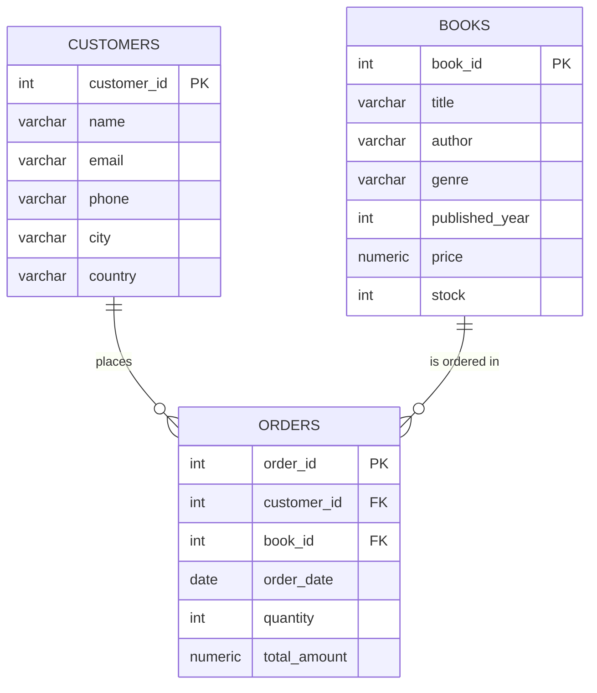

# 📚 Online Bookstore — SQL Analysis (PostgreSQL)

A hands-on SQL project that models an **online bookstore** with three relational tables (`BOOKS`, `CUSTOMERS`, `ORDERS`) and answers **25+ real-world business questions** using PostgreSQL — from simple filtering to multi-table joins, aggregations, and inventory analysis.


---

## 📑 Table of Contents

- [Project Overview](#-project-overview)
- [Objectives](#-objectives)
- [Repository Structure](#-repository-structure)
- [Dataset Description](#-dataset-description)
- [Database Schema](#-database-schema)
- [Getting Started](#-getting-started)
- [Business Questions & Queries](#-business-questions--queries)
- [SQL Concepts Demonstrated](#-sql-concepts-demonstrated)
- [Key Insights](#-key-insights)
- [Notes & Possible Improvements](#-notes--possible-improvements)
- [Tools Used](#-tools-used)
- [Author](#-author)

---

## 🔎 Project Overview

This project simulates the data layer of an online bookstore. It covers the full workflow of a typical SQL analysis task:

1. **Design** the relational schema (tables, primary keys, foreign keys).
2. **Load** raw CSV data into PostgreSQL using the `COPY` command.
3. **Analyze** the data with SQL to answer questions about sales, customers, inventory, and revenue.

The goal is to demonstrate practical, interview-ready SQL skills on a clean, easy-to-understand dataset.

## 🎯 Objectives

- Build a normalized database with proper **primary and foreign key** relationships.
- Import bulk data from CSV files into PostgreSQL.
- Write queries using **filtering, sorting, aggregation, grouping, and joins**.
- Derive business insights such as **top customers, best-selling genres/authors, revenue, and remaining stock**.

---

## 📁 Repository Structure

```
online-bookstore-sql-analysis/
│
├── books.csv                          # Book catalogue (500 rows)
├── customers.csv                      # Customer details (500 rows)
├── orders.csv                         # Order transactions (500 rows)
├── online_bookstore_sql_analysis.sql  # Schema creation, data import & all analysis queries
└── README.md                          # Project documentation
```

---

## 🗂 Dataset Description

| File | Rows | Description |
|------|-----:|-------------|
| `books.csv` | 500 | Book catalogue with title, author, genre, publication year, price and stock |
| `customers.csv` | 500 | Customer contact and location information |
| `orders.csv` | 500 | Purchase records linking customers to books |

**Quick facts about the data**

- **7 genres:** Fiction, Non-Fiction, Fantasy, Science Fiction, Mystery, Romance, Biography
- **Publication years:** 1900 – 2023
- **Book prices:** $5.07 – $49.98
- **Order period:** December 2022 – December 2024
- **Order quantity per order:** 1 – 10 books
- **Total stock across all books:** 25,056 units

### Column Dictionary

**`BOOKS`**

| Column | Type | Description |
|--------|------|-------------|
| `BOOK_ID` | `SERIAL` (PK) | Unique book identifier |
| `TITLE` | `VARCHAR(100)` | Book title |
| `AUTHOR` | `VARCHAR(100)` | Author name |
| `GENRE` | `VARCHAR(100)` | Book genre |
| `PUBLISHED_YEAR` | `INT` | Year of publication |
| `PRICE` | `NUMERIC(10,2)` | Unit price (USD) |
| `STOCK` | `INT` | Units currently in stock |

**`CUSTOMERS`**

| Column | Type | Description |
|--------|------|-------------|
| `CUSTOMER_ID` | `SERIAL` (PK) | Unique customer identifier |
| `NAME` | `VARCHAR(50)` | Customer full name |
| `EMAIL` | `VARCHAR(50)` | Email address |
| `PHONE` | `VARCHAR(15)` | Phone number |
| `CITY` | `VARCHAR(50)` | City |
| `COUNTRY` | `VARCHAR(100)` | Country |

**`ORDERS`**

| Column | Type | Description |
|--------|------|-------------|
| `ORDER_ID` | `SERIAL` (PK) | Unique order identifier |
| `CUSTOMER_ID` | FK → `CUSTOMERS` | Customer who placed the order |
| `BOOK_ID` | FK → `BOOKS` | Book that was ordered |
| `ORDER_DATE` | `DATE` | Date of the order |
| `QUANTITY` | `INT` | Number of copies ordered |
| `TOTAL_AMOUNT` | `NUMERIC(10,2)` | Order value (price × quantity) |

---

## 🧩 Database Schema



**Relationships**

- One **customer** can place many **orders** (`CUSTOMERS 1 → N ORDERS`).
- One **book** can appear in many **orders** (`BOOKS 1 → N ORDERS`).

---

## 🚀 Getting Started

### Prerequisites

- PostgreSQL 12+ (any recent version works)
- A client such as **pgAdmin**, **DBeaver**, or **psql**

### Setup Steps

1. **Clone the repository**
   ```bash
   git clone https://github.com/<your-username>/online-bookstore-sql-analysis.git
   cd online-bookstore-sql-analysis
   ```

2. **Create a database**
   ```sql
   CREATE DATABASE online_bookstore;
   ```

3. **Update the CSV file paths** in the `COPY` commands of `online_bookstore_sql_analysis.sql`.
   The script currently uses Windows paths such as:
   ```sql
   FROM 'C:\Users\Public\Books.csv'
   ```
   Change them to wherever you saved the CSV files on your machine.

4. **Run the script** in the following order: create tables → import CSVs → run analysis queries.

> 💡 **Tip:** `COPY` reads files on the *database server*. If you get a permission error, use `\copy` in `psql` instead, which reads from your local machine:
> ```sql
> \copy BOOKS FROM 'books.csv' DELIMITER ',' CSV HEADER
> ```
> Also make sure the file-name case in the script (`Books.csv`) matches the actual file names, especially on Linux/macOS.

> ⚠️ **Import order matters:** load `BOOKS` and `CUSTOMERS` **before** `ORDERS`, because `ORDERS` references both through foreign keys.

---

## 💼 Business Questions & Queries

### 🔹 Basic Queries

| # | Question | Techniques |
|--:|----------|------------|
| 1 | Retrieve all books in the **Fiction** genre | `WHERE` |
| 2 | Find books published **after 1950** | `WHERE` with comparison |
| 3 | List all customers from **Canada** | `WHERE` |
| 4 | Show orders placed in **November 2023** | `BETWEEN` on dates |
| 5 | Retrieve the **total stock** of books available | `SUM()` |
| 6 | Find the details of the **most expensive book** | `ORDER BY … DESC LIMIT 1` |
| 7 | Retrieve all orders where the **total exceeds $20** | `WHERE` |
| 8 | List all **unique genres** | `DISTINCT` |
| 9 | Find the book with the **lowest stock** | `ORDER BY … ASC LIMIT 1` |
| 10 | Calculate the **total revenue** from all orders | `SUM()` |

### 🔹 Intermediate / Advanced Queries

| # | Question | Techniques |
|--:|----------|------------|
| 11 | Show all customers who ordered **more than 1 copy** | `INNER JOIN`, filter in join condition |
| 12 | Total **books sold for each genre** | `JOIN`, `GROUP BY`, `SUM()` |
| 13 | **Average price** of books in the Fantasy genre | `AVG()` |
| 14 | List customers who have placed **at least 2 orders** | `JOIN`, `GROUP BY`, `HAVING COUNT()` |
| 15 | Find the **most frequently ordered book** | `JOIN`, `GROUP BY`, `COUNT()`, `LIMIT` |
| 16 | Show the **top 3 most expensive Fantasy books** | `ORDER BY`, `LIMIT 3` |
| 17 | Total **quantity sold by each author** | `JOIN`, `GROUP BY`, `SUM()` |
| 18 | List **cities** where customers spent **over $30** in total | `JOIN`, `GROUP BY`, `HAVING SUM()` |
| 19 | Find the **customer who spent the most** | `JOIN`, `GROUP BY`, `SUM()`, `LIMIT 1` |
| 20 | Calculate **remaining stock** after fulfilling all orders | `LEFT JOIN`, `COALESCE()`, arithmetic |

### 📝 Example Query — Remaining Stock After Orders

```sql
SELECT
    B.BOOK_ID,
    B.TITLE,
    B.STOCK,
    COALESCE(SUM(O.QUANTITY), 0)               AS TOTAL_SOLD,
    B.STOCK - COALESCE(SUM(O.QUANTITY), 0)     AS REMAINING_STOCK
FROM BOOKS B
LEFT JOIN ORDERS O ON O.BOOK_ID = B.BOOK_ID
GROUP BY B.BOOK_ID, B.TITLE
ORDER BY B.BOOK_ID ASC;
```

`LEFT JOIN` keeps books that were never ordered, and `COALESCE` converts their `NULL` sales to `0`, so every book appears in the result.

### 📝 Example Query — Top Customer by Spend

```sql
SELECT
    C.NAME,
    SUM(O.TOTAL_AMOUNT) AS TOTAL_SPENT
FROM ORDERS O
JOIN CUSTOMERS C ON O.CUSTOMER_ID = C.CUSTOMER_ID
GROUP BY C.NAME
ORDER BY TOTAL_SPENT DESC
LIMIT 1;
```

---

## 🧠 SQL Concepts Demonstrated

- **DDL:** `CREATE TABLE`, `PRIMARY KEY`, `FOREIGN KEY` (`REFERENCES`), data types (`SERIAL`, `VARCHAR`, `NUMERIC`, `DATE`)
- **Bulk data loading:** `COPY … FROM … CSV HEADER`
- **Filtering & sorting:** `WHERE`, `BETWEEN`, `ORDER BY`, `LIMIT`, `DISTINCT`
- **Aggregate functions:** `SUM`, `AVG`, `COUNT`
- **Grouping:** `GROUP BY`, `HAVING`
- **Joins:** `INNER JOIN`, `LEFT JOIN`, table aliases
- **NULL handling:** `COALESCE`
- **Calculated columns & aliases** for readable output

---

## 📈 Key Insights

Results computed from the provided dataset:

| Metric | Value |
|--------|-------|
| 💰 Total revenue | **$75,628.66** |
| 📦 Total stock across catalogue | **25,056 units** |
| 👥 Customers who placed at least one order | **307 of 500** |
| 🔁 Customers with 2 or more orders | **139** |
| 🏆 Top-spending customer | **Kim Turner — $1,398.90** |
| 🥇 Best-selling genre by units | **Mystery (504 units)** |
| 📉 Lowest-selling genre by units | **Fiction (225 units)** |
| 🛒 Orders in November 2023 | **25** |
| 💎 Most expensive book | **Proactive system-worthy orchestration ($49.98)** |
| ⚠️ Lowest stock | **Networked systemic implementation (0 units)** |

Units sold by genre: Mystery 504 · Science Fiction 447 · Fantasy 446 · Romance 439 · Non-Fiction 351 · Biography 285 · Fiction 225.

---

## 🛠 Notes & Possible Improvements

- **Ties are possible with `LIMIT 1`.** For example, two books (IDs 31 and 73) are tied as most frequently ordered (4 orders each); the query returns only one. Use `RANK()` / `DENSE_RANK()` or `FETCH FIRST 1 ROWS WITH TIES` to return all tied rows.
- **Foreign key column types.** `ORDERS.CUSTOMER_ID` and `ORDERS.BOOK_ID` are declared as `SERIAL REFERENCES …`. Plain `INT REFERENCES …` is the better practice, since foreign keys should not auto-generate values.
- **Group by ID, not name.** Some queries group customers by `NAME`; grouping by `CUSTOMER_ID` (plus name) is safer if two customers share a name.
- **Duplicate comment.** The "customers with at least 2 orders" heading appears twice: the first version actually filters on *quantity ≥ 2 in a single order*, while the second (`GROUP BY` + `HAVING COUNT(ORDER_ID) >= 2`) is the correct answer for "at least 2 orders".
- **Sequence reset after `COPY`.** Because IDs are loaded explicitly, run `SELECT setval(pg_get_serial_sequence('books','book_id'), MAX(book_id)) FROM books;` (and similarly for the other tables) before inserting new rows.
- **Ideas for extension:** monthly/yearly revenue trends using `DATE_TRUNC`, running totals and rankings with window functions, customer segmentation (high / medium / low spenders), views for recurring reports, and indexes on `ORDERS(customer_id, book_id)`.

---

## 🧰 Tools Used

- **PostgreSQL** — database engine
- **pgAdmin / DBeaver / psql** — query execution and management
- **Git & GitHub** — version control and portfolio hosting

---

## 👤 Author

**Rudrajit Paul**

- GitHub: [@your-username](https://github.com/rudropaul)

⭐ If you found this project useful, consider giving it a star!
